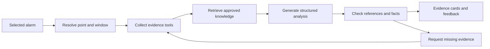
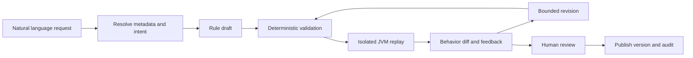
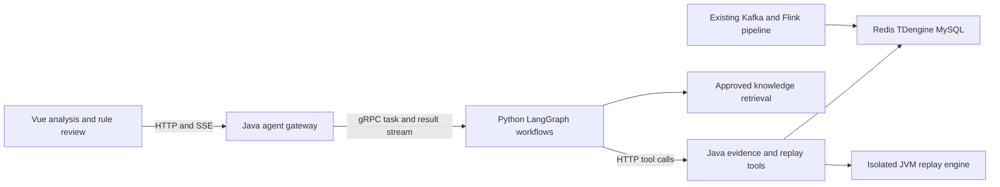

# N4 Monitor 融合 Agent 的专硕论文方案调研

调研日期：2026 年 10 月 3 日。源码检查基于本地提交 `17a0e07`。

本报告结合当前项目源码、已有选题调研、论文原始资料和框架官方文档，回答“怎样增加 Agent 能力，形成边界清楚、可以实现和评估的专硕论文工作”。这是选题和工程范围建议，不是已经实施或验证通过的系统设计。

## 1. 结论与适用条件

用户已经确认：

- 专业硕士，导师主要关注工作量，算法创新要求不高，不以发表论文为目标。
- 距离明年开题约有一年准备时间；尚未提供正式论文提交时间。
- 当前主要使用测试数据或模拟场景，不能假设已有真实故障根因标签。
- 希望直接使用 Python Agent 框架，此前讨论过 Java 与 Python 通过 gRPC 集成。

**建议主线：《面向设备监控的工具增强智能体告警分析与规则辅助配置系统设计与实现》。**

系统包含两个共享数据和工具的工作流：

1. **告警证据分析**：获取点位、历史、规则和知识资料，解释告警触发、延迟、等级变化和恢复，给出有来源的排查建议及缺失信息。
2. **规则辅助配置**：理解自然语言要求，查找点位并生成规则草稿，执行确定性校验和隔离回放，根据反馈修正，由用户审核后发布。

现有监控平台作为数据底座；新增证据层、知识管理、Agent 工作流、规则校验回放、交互页面和实验平台作为此次扩展的主体。两条工作流共享一个 Python 服务，首版无需建立多个相互讨论的 Agent。

从当前基础和一年准备期判断，这条路线能形成较完整的工程成果与实验材料。最终是否满足毕业工作量仍由导师和学校要求决定；本报告不以代码行数、模块数量或某个样本数作为毕业标准。

如果资料建设进展不顺，可收缩为《面向设备监控的自然语言告警规则辅助配置与回放验证系统设计与实现》。规则行为有清楚的预期，适合目前以模拟数据为主的条件。

## 2. 当前项目真正具备的基础

本次只读核查了源码、配置和测试，不启动外部服务，不报告本轮未运行的测试为“通过”。部分已有说明文档已落后于源码，以下以实际代码为准。

| 现有能力 | 可以承担的论文工作 | 已核查证据与边界 |
|---|---|---|
| MQTT/Kafka 点位数据进入 Flink | 获取监控观测、重放标准输入 | [PointData.java](E:/Curzsu/N4-monitor/monitor-common/src/main/java/com/n4monitor/alarm/model/PointData.java:11) 明确以 `mqttPath` 关联部署地址，优先使用稳定路径标识 |
| 数值和枚举告警规则 | 规则解释、自然语言配置目标、确定性实验基线 | [RuleEvaluator.java](E:/Curzsu/N4-monitor/monitor-flink-job/src/main/java/com/n4monitor/flink/RuleEvaluator.java:99) 实现阈值、优先序、枚举和死区；不是任意规则语言 |
| 告警生命周期与延迟确认 | 解释为什么触发、为什么仍待确认、如何切换和恢复 | [AlarmProcessFunction.java](E:/Curzsu/N4-monitor/monitor-flink-job/src/main/java/com/n4monitor/flink/AlarmProcessFunction.java:325) 有 pending 与生命周期处理 |
| Redis 最新点位和活动告警 | 获取当前证据快照 | [RedisStateStore.java](E:/Curzsu/N4-monitor/monitor-flink-job/src/main/java/com/n4monitor/flink/RedisStateStore.java:52)；最新值也需要附带观测时间和新鲜度 |
| Redis Streams 与 TDengine 事件存储 | 查询告警前后窗口、保留证据 | [AlarmStreamConsumer.java](E:/Curzsu/N4-monitor/monitor-backend/src/main/java/com/n4monitor/alarm/stream/AlarmStreamConsumer.java:205)；通知仍使用 Pub/Sub，历史持久化已使用 Streams |
| MySQL 模板、部署、点位、规则 | 点位定位、单位和类型约束、规则绑定 | [PointDeployment.java](E:/Curzsu/N4-monitor/monitor-backend/src/main/java/com/n4monitor/deployment/entity/PointDeployment.java:7) |
| Vue 页面、设备导航和告警页面 | 分析入口、证据跳转、规则草稿审核 | 已有页面可以承载扩展，仍需新增分析与回放交互 |
| 规则状态机测试夹具 | 复用真实生产逻辑，建立廉价确定性回放 | [AlarmHarness.java](E:/Curzsu/N4-monitor/monitor-flink-job/src/test/java/com/n4monitor/flink/AlarmHarness.java:32) 使用内存 Redis、可控 timer 和生产函数；当前不是通用多点位回放服务 |

### 2.1 实验前必须处理的四个数据问题

**第一，部分界面数据是模拟值。** [MonitorPointController.java](E:/Curzsu/N4-monitor/monitor-backend/src/main/java/com/n4monitor/device/controller/MonitorPointController.java:25) 每次随机设置点位值与状态。[DashboardService.java](E:/Curzsu/N4-monitor/monitor-backend/src/main/java/com/n4monitor/dashboard/service/DashboardService.java:48) 中 Top5 告警、部分系统状态与多个趋势仍为固定或随机生成。Agent 的证据工具应读取部署元数据、实际 Redis 快照和 TDengine 数据；评测时避免混入每次请求都会改变的模拟返回值。

**第二，现有历史接口不足以直接支持证据检索。** [AlarmController.java](E:/Curzsu/N4-monitor/monitor-backend/src/main/java/com/n4monitor/alarm/controller/AlarmController.java:41) 的历史接口主要接收 `topTs/offset/limit`。[TdengineSql.java](E:/Curzsu/N4-monitor/monitor-backend/src/main/java/com/n4monitor/tdengine/TdengineSql.java:72) 将写入时刻作为主键 `ts`，原始观测时间另存 `data_timestamp`。分析故障发生前后时，应按点位路径和观测时间检索，明确观测时间、处理时间、写入时间三种口径。

**第三，部署导航层级不是物理依赖图。** [NavNode.java](E:/Curzsu/N4-monitor/monitor-backend/src/main/java/com/n4monitor/dashboard/entity/NavNode.java:7) 提供组织父子关系，没有明确的供电、通信、冷却依赖边。首版可以按同设备、同部署范围查询；只有在补充并审核依赖关系后，才引入依赖约束分析。位置相邻或同属一个节点不能作为因果关系证据。

**第四，权限和数据来源标记需要落实到工具。** [SecurityConfig.java](E:/Curzsu/N4-monitor/monitor-backend/src/main/java/com/n4monitor/security/SecurityConfig.java:46) 提供登录校验，部分写接口有动作权限；源码核查未发现关键告警、部署和导航查询消费设备数据范围。新工具接口需要服务端范围过滤。`isReal`、`isMock` 与模板名或命名前缀有关，不能单独证明某条遥测来自现场；实验应另存明确的数据来源与场景标识。

另外，当前仓库未找到故障根因标签、维修工单、手册关联、诊断知识库和诊断任务实体。`Ack` 表示确认告警，不表示确认原因。README 引用的 `test-producer` 目录当前不存在；[regression_test.py](E:/Curzsu/N4-monitor/scripts/regression_test.py:3) 是 HTTP/权限回归脚本，应另外建设遥测场景生成器。

Streams 的消费确认也不能直接等同于端到端 exactly-once。当前存在长度裁剪，写入键还受写入时间影响；实验的事件去重和回放一致性需要独立验证。此项只列为实验数据口径问题，不建议为了选题额外扩展成分布式一致性研究。

## 3. 三条融合路线的取舍

| 路线 | 主要新增内容 | 数据依赖 | 对当前目标的判断 |
|---|---|---|---|
| 监控问答/RAG 助手 | 聊天界面、手册检索、文本回答 | 一批设备资料即可 | 可作为早期原型或其中一个模块；单独作为主线时，业务处理与实验深度容易不足 |
| 告警证据分析 + 规则辅助配置 | 证据工具、工作流、草稿校验、回放、审核、实验平台 | 模拟点位、独立预期、少量审核知识 | **主推**：可复用现有系统，功能和定量实验可以互相支撑 |
| 自动根因诊断/预测性维护/自适应控制 | 物理依赖、故障标注、模型训练、控制策略等 | 高质量现场数据、机理资料和较强评审支撑 | 当前资料不足，宜作为后续展望或有数据后再选择的方向 |

本次推荐来自已核查的条件，不代表第二条路线比所有其他方案普遍更优。用户已明确无需追求发表级算法创新，因此不把微调、强化学习、图神经网络、完整知识图谱或复杂多智能体列为必做项。

## 4. 相关研究说明了什么

本次是定向调研，未进行穷尽性系统综述。下表区分任务、证据层级和可借鉴内容；不把论文在其他领域的效果数字套用于本项目。

| 原始研究或资料 | 核实的内容 | 对本项目的意义 |
|---|---|---|
| Wang 等，RCAgent，2023 预印本，CIKM 2024 | 作者论文与发表记录已核对；使用工具增强 Agent 诊断阿里云 Flink 平台异常，组织领域知识和证据 | 借鉴受约束工具、观测留存和证据输出。其任务是软件平台故障，与被 Flink 监控的物理设备故障有区别。[论文](https://arxiv.org/abs/2310.16340) |
| Chen 等，AIOpsLab，MLSys 2025 | 正式会议论文摘要与官方项目已核对；组织故障注入、负载、遥测、环境接口和 Agent 评估 | 借鉴场景、隐藏真值、交互轨迹和统一评分的组织方式。无需给 N4 引入整套 Kubernetes 环境。[会议论文](https://proceedings.mlsys.org/paper_files/paper/2025/hash/d1f9e4a9f109b6e8b75ed362736f22ec-Abstract-Conference.html)、[官方项目](https://github.com/microsoft/AIOpsLab) |
| Xu 等，OpenRCA，ICLR 2025 | 正式会议论文已核对；面向软件故障的多源遥测根因分析基准 | 借鉴对象、原因和时间分项评价。公开软件案例不能替代 N4 物理设备标签。[会议论文](https://proceedings.iclr.cc/paper_files/paper/2025/hash/d29b8d53678015079e1d245c023e49d2-Abstract-Conference.html) |
| Liu 等，CNC 故障诊断，Engineering 2025 | 期刊原文已核对；融合设备知识图谱、工程数据、多轮 RAG 和反馈更新 | 设备知识与大模型结合已有研究基础；本项目需要自己的资料组织、工具接口和评测，不能把“加入 RAG”表述为首次提出。[期刊原文](https://www.engineering.org.cn/engi/EN/10.1016/j.eng.2025.04.003) |
| Cosler 等，nl2spec，2023 | 原始论文已核对；将自然语言片段与时序逻辑子表达式对应，并通过交互处理歧义 | 借鉴意图片段、参数解释与澄清；本项目使用受限告警配置，不等同于建立完整时序逻辑验证系统。[论文](https://arxiv.org/abs/2303.04864) |
| Chen 等，Teaching Large Language Models to Self-Debug，2023 预印本 | 原始论文已核对；用程序解释和执行反馈帮助修正生成程序 | 支持生成、执行、反馈、修正的设计思路。此模式已有相关工作，贡献应具体落在告警语义和系统实现。[论文](https://arxiv.org/abs/2304.05128) |
| Yao 等，τ-bench，2024 | 原始论文已核对；根据工具操作后的终态评分，并评估多次运行一致性 | 借鉴状态与行为评测，避免只用文本相似度或模型自评分评价系统。[论文](https://arxiv.org/abs/2406.12045) |
| Jung 等，LiU-ICE，2024 | 论文及大学官方基准页已核对；真实发动机试验台故障诊断，评估误报、漏报、延迟和隔离等 | 借鉴正常、故障幅度、工况、未知故障的实验分层。它不是 N4 数据，也不是纯模拟数据，当前不作为必须接入的数据源。[论文](https://arxiv.org/abs/2408.13269)、[大学基准页](https://vehsys.gitlab-pages.liu.se/diagnostic_competition/en/index_competition_24.html) |

此外，清华官方记录确认了王泽凡 2024 年硕士论文《基于大语言模型智能体的云计算根因分析框架研究》与夏添 2025 年硕士论文《基于大语言模型和求解器的装备运维综合管理技术研究》。本次仅核对公开摘要与学位信息，不能推断全文实验和原始目录，也不能据此判断用户所在学校的工作量要求。[王泽凡官方记录](https://newetds.lib.tsinghua.edu.cn/qh/paper/summary?dbCode=ETDQH&sysId=288965)、[夏添官方记录](https://newetds.lib.tsinghua.edu.cn/qh/paper/summary?dbCode=ETDQH&sysId=302800)

本课题适合描述为：**围绕具体设备监控业务，设计与实现融合多源证据、工具调用、确定性规则校验和回放反馈的辅助运维系统，并在声明的场景范围内评价其行为、可靠性和运行开销。** 这是候选工程贡献定位，不是“尚无人研究”或“首次实现”的结论。

## 5. 工作流一：告警证据分析

### 5.1 用户看到的业务能力

入口放在活动告警或历史告警详情页，用户选择一条告警后点击分析。普通聊天查询也可以复用同一流程。

第一版回答这些具体问题：

- 为什么该点位在这个时刻触发告警？是哪一条规则、哪个阈值？
- 为什么越限后还没有出现已确认告警？短时尖峰是否被延迟过滤？
- 为什么从 `High-High` 变成 `High`，或者恢复后仍出现在未确认列表？
- 同设备或同部署范围内，哪些其他点位在相近时间发生异常？
- 现有证据支持哪些排查方向，还缺少哪些观测才能区分？

这些问题能够由当前规则与数据直接核验，先于开放式“设备究竟坏在哪里”。

### 5.2 处理流程

查询、统计、排序和时间对齐由程序执行。Agent 根据已有结果决定补查哪个点位或哪个时间段，并将数值与知识组织成说明。限制工具轮数、查询窗口和返回量，以保证流程可以停止、记录和复现。

历史触发原因应结合告警发生时生效的规则快照。当前尚未建立完整规则历史版本时，只能说明“根据当前规则重新分析的结果”，不能将现行阈值当作当时实际阈值。新增规则版本管理需要记录生效时间，并把规则版本关联到事件或证据快照；缓存生效延迟也应纳入口径。

### 5.3 统一证据结构

每条证据至少记录：

- `evidence_id`、点位稳定标识、设备部署标识、来源类型。
- 观测时间或查询窗口、查询时刻、规则和资料版本。
- 原始记录位置或可复查查询参数、单位、数据新鲜度。
- 程序计算的统计结果，例如越限开始、最大值、持续时间、缺测段。

输出分成“观测事实、规则解释、候选原因、下一步检查、尚缺证据”。重要事实绑定证据编号，前端可以跳回点位趋势、规则详情或资料段落。

程序能检查引用是否存在、数值是否一致、设备与时间范围是否匹配。物理原因是否充分成立，需要场景预期或领域评审；引用存在并不自动证明因果推断正确。

### 5.4 示例与能力边界

在一个拟建模拟温度场景中，Agent 可以输出：某点位连续越限后按规则确认；同设备另一点位同步变化；依据指定资料建议检查传感器与环境状态；目前无法区分真实温升和传感器偏置，需要独立观测。

如果模拟器只让温度数值升高，没有设备机理或额外观测，不能把“制冷故障”作为必然正确答案。构造不可辨识场景并测试系统是否承认证据不足，比要求每个场景都给出单一原因更可信。

## 6. 工作流二：规则辅助配置与回放

### 6.1 从自然语言到可审查草稿

示例请求采用拟建测试点位，不代表仓库中已有该设备：

> 把 TEMP-01 温度点位设置为达到 30 °C 持续 120 秒后产生 Major 告警，低于 28 °C 恢复，短暂越限不要确认告警。

Agent 先查点位身份、类型、单位、现有规则和引擎能力，再形成单个高阈值草稿：`highValue=30`、`deadband=2`、`timeDelay=120`。草稿需要明确当前引擎采用最后观测值保持的延迟策略，以及严格低于恢复边界的语义。

“温度过高就报警”“持续一会儿”“超过 30”这类请求可能缺参数或存在严格比较歧义，应产生澄清项。不能通过猜测参数消除歧义，也不能把跨点联合条件默默改写成单点规则。

### 6.2 处理流程

回放和发布分开。Agent 使用草稿与分析工具；发布由经过权限检查的后端审核动作执行。每次修正保存版本差异、校验错误和回放轨迹，便于论文展示整个执行过程。

实际配置流程的预期来自用户确认的参数、行为要求或审核过的示例。历史回放也可以用于比较新旧规则的行为变化，但没有独立预期时，这种比较不能证明新草稿符合意图。实验使用单独保存的标准预期；实际流程同样不能让模型自行生成一份预期，再以匹配它为理由证明自己的草稿正确。

### 6.3 先定义现有引擎的能力契约

| 项目 | 当前实际语义 | 新系统应如何处理 |
|---|---|---|
| 数值触发 | 高侧 `>=`、低侧 `<=`，优先序为 HH、H、LL、L | 对严格 `>`/`<` 要求澄清或拒绝；避免用浮点微调伪装等价 |
| 可表达条件 | 每点静态数值阈值或枚举匹配 | 跨点组合、变化率、滑动窗口均作为能力不足，不列入首版必做 |
| 延迟与死区 | 每点共享一个 delay、绝对数值 deadband | 单位转换和参数解释必须明确；不自动支持百分比死区或每等级独立 delay |
| 恢复死区 | 当前值不再触发任何原始阈值时才进入死区判断；高侧严格小于阈值减死区才恢复，低侧严格大于阈值加死区才恢复 | 将等号边界列入回放；死区不是所有等级切换的保护带 |
| 等级变化 | 活动告警 level 变化时旧 end、新 start，不重新延迟 | HH→H 同样是等级切换，不等于恢复或重新等待确认 |
| 枚举 | 匹配忽略大小写；空 severity 为显式正常；未知值跳过 | 检查归一化后重复项；未知值不自动当正常，也不保证取消 pending |
| 时间 | 由首个事件时间计算目标，但使用 processing-time timer | 回放同时明确数据时间和模拟处理时间 |
| 断流 | pending 默认按最后值保持，到时仍可能确认 | 与“连续收到异常采样”区分；数据新鲜度另行显示 |

源码证据见 [RuleEvaluator.java](E:/Curzsu/N4-monitor/monitor-flink-job/src/main/java/com/n4monitor/flink/RuleEvaluator.java:204)、[AlarmProcessFunction.java](E:/Curzsu/N4-monitor/monitor-flink-job/src/main/java/com/n4monitor/flink/AlarmProcessFunction.java:531) 和 [PendingAlarm.java](E:/Curzsu/N4-monitor/monitor-flink-job/src/main/java/com/n4monitor/flink/PendingAlarm.java:18)。

### 6.4 确定性校验和回放的新增内容

静态校验包括结构、点位存在性、类型、单位、有限数值、非负延迟与死区、阈值顺序、severity 词表、枚举归一化冲突和引擎能力。缺少某一级阈值时保留缺级，不自动补出其他级别。

回放复用 Java/Flink 的实际求值和生命周期逻辑，固定规则快照、点位元数据、初始状态与模拟时钟，隔离所有生产写入。首版可以从现有 `AlarmHarness` 提取适配器，每点独立运行；它当前只有单个 pending state，直接混入多个点位会破坏隔离。随后补多键隔离与少量真实 Flink 集成验证。

输出比较 `start/end` 顺序、等级、severity、确认与恢复时刻、最终 active/latest 状态，并给出失败轨迹片段。将老的历史时间戳直接送入当前实时引擎可能使延迟立即到期，因此回放必须控制 processing time 并驱动 timer。

四种“正确”需要分开报告：

1. **结构合法**：输出符合字段规范。
2. **业务合法且可执行**：类型、单位、约束合理，能被引擎执行。
3. **有限轨迹符合预期**：在指定输入与时间假设下，行为与独立预期相符。
4. **形式化证明**：对明确形式模型证明性质或等价性。

本课题建议完成前三层。有限回放不能表述为证明所有可能输入都符合用户意图，也不自动继承外部验证框架的正确性保证。[LLM-Modulo 的原始讨论](https://proceedings.mlr.press/v235/kambhampati24a.html)可帮助区分模型提案与外部验证器的责任。

## 7. 架构与工具接口

建议保持现有实时告警链路，新建独立 Python 服务。沿用此前讨论的 gRPC 方案：Java→Python 的任务启动和结果流使用 gRPC；前端→Java 使用 HTTP/SSE；Python 查询既有 Java 业务工具时，首版复用受权限约束的 HTTP/JSON 接口。三条连接各有固定职责。

LangGraph 支持把确定性步骤与模型驱动步骤组合，并提供持久化、流式处理和人工介入能力；原型可以利用 LangChain 的预置 Agent 减少基础循环代码。使用框架不免除业务工具、状态存储和实验设计工作。[官方说明](https://docs.langchain.com/oss/python/langgraph/overview)

gRPC 支持普通调用和服务端流，可以将任务阶段、工具事件与结果逐步发送给 Java，再转换给浏览器。需要定义 `.proto`、超时、取消、任务标识和错误结构。它是集成选择，不是论文方法贡献；Python 只提供 gRPC 服务时，FastAPI 不是必需依赖。[官方说明](https://grpc.io/docs/what-is-grpc/core-concepts/)

实时检测仍由 Flink 承担。首版分析可由用户点击触发；后续按告警事件触发分析时，增加去重、频率限制和任务队列，避免每条点位采样都启动模型。现有 Kafka 或 Streams 可按需要复用。

### 7.1 建议工具清单

以下是拟建工具，不表示已有同名 API。

| 工具 | 输入与输出 | 实施方式 |
|---|---|---|
| `resolve_point` | 设备范围、名称或路径→稳定点位、单位、类型、部署与规则绑定 | 复用部署/模板元数据，歧义时返回候选列表 |
| `get_point_latest` | 点位列表→实际最新值、观测时间、新鲜度 | 新增批量读取工具，使用 Redis 快照 |
| `get_point_window` | 路径、观测时间窗口→记录或降采样 | 新增 TDengine 查询，限制窗口和返回量 |
| `summarize_point_window` | 同上→统计量、越限区间、缺测区间 | 程序计算，保留可复查参数 |
| `get_alarm_timeline` | 点位与窗口→告警生命周期 | 复用事件存储，明确时间口径和稳定排序 |
| `get_bound_rule` | 点位、分析时刻→规则快照与能力版本 | 复用绑定映射，新增历史版本；历史版本缺失时明确返回当前规则 |
| `search_knowledge` | 设备型号、现象、问题→资料片段与来源 | 新增知识管理和受约束检索 |
| `validate_rule_draft` | 草稿→机器可读错误、澄清项 | 新增确定性校验器 |
| `replay_rule_draft` | 草稿、场景或窗口→结构化轨迹、差异 | 新增隔离 JVM 回放服务 |
| `save_task_feedback` | 任务、人工评审→审计与反馈状态 | 新增任务和评审记录 |

初版不开放任意 SQL、任意文件执行或任意规则发布工具。范围限制属于具体业务接口设计；用户身份与设备范围由 Java 验证，不能让模型自行决定权限。

## 8. 可以清楚展示的新增工作量

| 工作包 | 核心新增工作 | 可审查交付物 | 与论文的对应关系 |
|---|---|---|---|
| W1 数据与证据接口 | 消除分析链路中的随机数据，补点位/时间窗口/元数据查询、摘要与范围过滤 | 工具契约、API、数据口径说明、查询测试 | 数据基础与需求分析 |
| W2 知识与案例管理 | 资料导入、分段、设备关联、版本与来源、检索；反馈经审核再入库 | 可核对知识集、检索界面、相关性标注 | 知识组织与证据检索 |
| W3 Python Agent 工作流 | 工具选择、结构化分析、引用检查、补查、终止与异常处理、执行留痕 | 独立服务、任务状态、调用记录、分析结果 | 智能体工作流设计 |
| W4 规则配置与验证 | 意图定位、受限草稿、校验、Java 回放、错误反馈修正、版本审核 | 草稿与版本、校验报告、轨迹差异、发布审计 | 规则辅助配置设计 |
| W5 前端与集成 | 告警分析入口、证据卡片与跳转、任务进度、规则对比、回放曲线 | 端到端可操作系统、部署配置 | 系统实现与案例 |
| W6 场景与实验平台 | 场景生成、隐藏预期、分组数据划分、基线/消融、重复运行与成本统计 | 可复现数据、运行配置、结果表、失败分析 | 实验评价 |

现有设备管理、Flink 告警和展示页面作为已完成系统基础单独说明；新增工作围绕表中的六个包列出。这样既能利用现有成果，也能明确此次 Agent 扩展实际做了什么。

建议保存的实体包括任务、工具调用、证据、知识资料、规则草稿/版本、回放运行和场景元数据。按实际需求合并表即可，首版沿用 MySQL 与文件存储；知识规模小可以先采用关键词/全文检索，向量检索作为可替换组件，不必为技术数量新增多套存储。

知识管理关注资料来源和审核，不要求建立复杂实体抽取模型或图谱补全。反馈管理区分“用户表示有帮助”“人工确认事实”“确认根因”，不能把所有点赞都升级成已验证故障知识。

## 9. 以模拟数据为主，怎样建立有效实验

### 9.1 三类数据分别管理

| 数据类 | 如何建设 | 能支持的评价 |
|---|---|---|
| 规则行为场景 | 独立定义意图、标准配置、数值/枚举序列、处理时钟、初始状态、预期事件 | 草稿语义、确认与恢复、反馈修正；当前最稳的定量任务 |
| 告警分析场景 | 组合点位时序、规则、部署范围和少量审核知识，定义必须引用的事实与允许的排查方向 | 证据获取、规则解释、时间定位、引用和信息不足处理 |
| 模拟物理故障场景 | 只有在声明机理、依赖及注入机制后才建设；真实原因与观测分开保存 | 声明的模拟系统内的原因候选识别，不能推出现场效果 |

每个场景记录 `scenario_id`、生成器版本、随机种子、数据来源、规则版本、开始时间、采样计划、时钟策略与预期输出。变换幅度、噪声、采样间隔、名称和设备范围，避免固定模板只靠关键词就泄漏答案。

Agent 可见输入与隐藏标签分开。文件名、场景标题、资料片段和告警消息中不得透露待评分的注入原因。模拟模型与知识资料可以公开其一般机制，但不要给待诊断实例直接标注答案。

### 9.2 起步场景

先分别为两条工作流准备约 10—20 个基础任务，确认工具完整性、评分标准和难度。这是建议的原型规模，不是正式样本量或毕业标准。后续按独立需求/事件、覆盖范围、误差分析与可投入标注时间确定规模。

规则任务至少覆盖：高/低阈值、四级优先序、等号边界、缺级、高/低死区、短时尖峰、恰好到时、pending 同级刷新、pending 等级切换、断流、活动升降级、枚举大小写与未知值、恢复确认、再次告警、非法/歧义/越能力请求。

分析任务至少覆盖：单点越限解释、短时波动、多点同设备异常、同名不同设备、观测与写入时间错位、缺测/陈旧值、无关告警干扰、错误单位或规则绑定、缺知识、存在多个可解释原因、工具失败、超范围访问。

同一场景换几个数字和名称并不等于获得多起独立故障。数据划分按需求模板、规则结构和场景机制分组，报告独立组数；重复种子和改写作为组内变体。

### 9.3 回放真值的独立性

标准规则和预期事件由独立规范、人工编写或审核生成，保留边界说明。现有测试可以成为种子，但不能仅把生产引擎输出重新标为“独立真值”，否则主要证明系统能复述自己。

Agent 可以看到修正用轨迹或失败反例；最终效果在未展示的测试轨迹上评分。明确回放验证集与最终测试集的区别。规则版本、metadata 和时钟固定，避免缓存变化影响对照。

### 9.4 能得出什么结论

模拟实验可以说明：在声明的场景、规则能力和时间假设下，系统能否正确获取证据、解释告警、处理歧义、生成合规配置和完成回放反馈，以及各步骤的成本与稳定性。

它不能直接说明真实设备根因诊断准确率、预测性维护能力、真实停机减少或现场收益。以后获得现场资料时，另外组织真实案例小组，分别报告结果和来源，不混入模拟组计算“真实诊断准确率”。

## 10. 基线、消融与评价指标

### 10.1 告警分析对照

| 方法 | 输入与机制 | 要检验的问题 |
|---|---|---|
| A0 固定排查模板/确定性解释器 | 相同告警、规则和可见数据，用程序解释生命周期 | 规则化任务中低成本方法能达到什么水平 |
| A1 LLM 静态摘要 | 相同模型，预先整理固定窗口证据 | Agent 动态查询相对静态输入是否有价值 |
| A2 普通资料检索 | 静态摘要 + 相同知识库检索 | 资料检索的作用 |
| A3 工具增强分析 | 动态查询 + 相同知识库和预算 | 证据补查的收益与开销 |
| A4 完整流程 | 工具增强 + 设备/时间约束 + 引用/事实检查 | 约束和事实检查的收益 |

分别移除知识检索、动态补查、设备/时间约束、引用校验，观察效果与成本。各方法共享合法范围和同一资料集；静态基线也允许读取同一范围的数据，不能人为剥夺基础证据来制造 Agent 优势。

### 10.2 规则生成对照

| 方法 | 机制 |
|---|---|
| B0 模板/关键词解析器 | 受限语法输入的低成本参照 |
| B1 单轮生成 | 同一模型一次结构化输出 |
| B2 多轮自检 | 相同修正预算，无确定性反馈 |
| B3 校验反馈 | 静态校验结果驱动有限轮修正 |
| B4 校验 + 回放反馈 | 静态错误与行为反例驱动有限轮修正 |

人工标准规则用来校验回放链路的上限，不作为与 Agent 具有同等输入条件的竞争方法。预算匹配时除限制轮数，还要记录 token、模型调用数和耗时，必要时补相近预算的多候选基线。

### 10.3 主要指标

| 评价对象 | 建议指标 | 解释边界 |
|---|---|---|
| 工具与证据 | 查询正确率、对象/时间范围准确性、引用存在率、数值一致性 | 引用存在与物理推断成立分开评分 |
| 告警分析 | 规则解释正确率、关键事实覆盖、候选检查相关性、信息不足处理 | 模拟根因命中单独标为模拟评价 |
| 规则草稿 | 结构合法率、业务合法率、正确澄清/拒绝率、错误接受率 | JSON 合法不等于配置语义正确 |
| 规则行为 | 隐藏轨迹完整匹配率、事件精确率/召回率、确认与恢复时刻误差 | 有限轨迹结果，不是全输入证明 |
| 反馈效果 | 修正成功率、修正次数、错误类型变化 | 与更多调用预算带来的收益区分 |
| 稳定性与工程 | 重复运行一致性、工具失败后的完成率、延迟分布、token、调用数 | 模型版本、部署方式和预算一并报告 |
| 用户任务 | 完成正确性、用时、可操作性 | 若参与者是学生，仅说明该用户实验条件，不推广为资深运维效率 |

模型可辅助检查文本，主要事实和行为指标采用程序与明确评分规则；开放式建议安排人工复核。模型自评分不能独立证明它的结论正确。

固定提示、资料版本、模型标识、温度、调用上限和运行配置；对代表场景重复运行。对比例和效果差异给出置信区间，按独立场景/需求组抽样，避免把高度相似的改写当独立样本。结果没有明显提升时，报告哪些任务固定模板更适合、哪些任务工具补查有价值，以及成本交换关系。

## 11. 论文内容与一年准备安排

### 11.1 候选章节

这是为本项目新拟的结构，不是已检索论文的原始目录；学校模板优先。

| 章节 | 内容 | 应具备的材料 |
|---|---|---|
| 第 1 章 绪论 | 监控业务、目标、相关方向、范围与贡献 | 具体问题、数据条件、同类系统比较 |
| 第 2 章 技术与相关工作 | 设备告警、工具 Agent、检索、执行反馈、评测 | 核实文献与选型依据 |
| 第 3 章 需求和总体设计 | 现有系统、新增模块、数据模型、接口与权限 | 架构、契约、数据口径 |
| 第 4 章 告警证据分析 | 工具、证据组织、检索、分析流程、事实检查 | 实现、样例、组件评价 |
| 第 5 章 规则辅助配置与回放 | 规则能力、草稿、校验、时钟、反馈与审核 | 行为实验、反例、版本与页面 |
| 第 6 章 系统实现与实验 | 部署、两条业务流程、对照、稳定性与成本 | 可运行系统和可复现结果 |
| 第 7 章 总结与展望 | 对照目标总结，说明模拟与现场边界 | 由实验支持的结论 |

不要求为了分成两章而人为制造两个算法创新点。若最终收缩为规则主线，可合并告警分析内容到需求和实现章节。

### 11.2 一年开题准备期的建议节奏

以下月份是相对阶段，不是论文提交截止日期；按实际每周投入调整。

| 阶段 | 目标 | 阶段完成证据 |
|---|---|---|
| 第 1—2 月 | 选一个设备范围，梳理规则语义，完成两条流程的小样本试验 | 数据清单、能力契约、标准预期、简单基线结果 |
| 第 3—4 月 | 实现证据查询与资料管理，打通 gRPC 原型 | 点位/历史/规则工具、可追溯资料、任务调用链 |
| 第 5—6 月 | 完成告警分析页面和可停止、可审计的工具流程 | 证据卡片、事实检查、异常处理与首轮对照 |
| 第 7—8 月 | 完成规则草稿、确定性校验、单点回放及审核 | 轨迹差异、反馈修正、版本/审核演示 |
| 第 9—10 月 | 扩展场景、处理多键隔离、做基线消融和稳定性实验 | 锁定评测集、重复运行、成本及失败分析 |
| 第 11—12 月 | 整理开题方案、原型、已有结果与后续计划 | 明确题目、模块清单、实验设计、可演示系统 |

开题前可以提前获得原型和小规模结果，不必等待一年后才验证方向。正式论文的扩大实验与写作应根据开题后的安排另行制定。

## 12. 范围控制与优先级

**必做**：真实快照/历史证据接口、明确的规则语义、两条工作流中的可核验流程、隔离回放、证据/版本记录、前端交互、对照实验。

**视资料与进度选做**：有限的类型化设备依赖、向量检索、跨告警的事件分组、自动告警触发分析、多点位回放和小规模用户任务实验。

**暂不列入**：通用自动根因系统、预测性维护、生产设备自动控制、跨点任意规则语言、强化学习、完整数字孪生、为展示规模而增加多套中间件和大量 Agent。

如果导师认为范围偏大，优先保留规则辅助配置、校验、回放与实验，告警分析只做规则触发/恢复解释。如果后续获得手册、可靠故障案例和依赖资料，再扩大候选原因分析。两种收缩都可保留明确的业务成果。

## 13. 最先应该验证的三个问题

1. **数据闭环是否成立？** 选一个真实路径或明确标记的模拟路径，通过后端查到 metadata、最新值、历史窗口和当前规则，确认单位与时间一致。
2. **规则闭环是否成立？** 将一个清楚的自然语言请求生成草稿，送入隔离生产引擎，比较独立预期，返回一条真实错误，再观察 Agent 是否正确修正。
3. **Agent 的增量价值在哪里？** 与固定模板、单轮生成和相同预算的自检比较，找出工具补查或回放反馈实际有效的任务，而不是预先假定所有任务都需要 Agent。

建议下一步先做这三个小规模验证并与导师讨论本报告的题目和模块范围，再进入正式实施设计。当前报告不包含模型效果、现场诊断准确率或工作量达标的实证结论。
