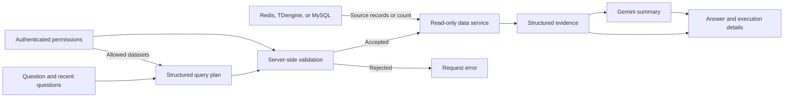

# 面向工业设备监控的受约束自然语言问数方法与系统实现

*Constrained Natural-Language Querying for Industrial Equipment Monitoring: Method and System Implementation*

## 摘要

工业设备监控中的实时告警、历史告警帧与设备部署记录具有不同的统计口径。自然语言问数需要识别用户要查询的对象，同时遵守平台的访问权限，并让用户看出返回的数字是如何得到的。本文以 N4 Monitor 为例，实现了一种以结构化查询计划为中间表示的问数方法。大语言模型从用户问题中选择数据集和查询操作，服务端校验计划并调用既有数据服务完成取数和统计。系统将结构化证据与自然语言摘要分别返回，并展示查询计划、数据来源及执行阶段耗时。组件测试验证了越权计划的拦截、实时告警的筛选与分组、历史告警帧读取超限时的拒绝，以及摘要失败时的证据保留。结果表明，在所测场景内，数据集授权、统计执行和证据返回可分别验证。本文进一步设计了基于固定数据快照和独立真值的对照实验，用于评估自然语言解析的正确性、拒绝行为和模型调用开销。

**关键词**　工业设备监控，问数 Agent，结构化查询计划，访问控制，告警帧

## 1 引言

“现在有哪些 UPS 告警”和“今天写入了多少条 UPS 告警帧”都可以通过设备监控平台回答，但两个问题对应的记录集合不同。前者针对当前告警快照，后者针对指定日期内写入历史库的帧。同一次告警可以产生多条历史帧，按帧计数与按独立告警事件计数会得到不同结果。自然语言入口如果忽略这一差异，即使顺利执行查询，也可能给出统计口径错误的答案。

跨域自然语言转 SQL（Text-to-SQL）研究考察了从问题到可执行查询的映射。Spider 以跨库测试检验对新数据库的泛化，Spider 2.0 则将评价扩展到企业场景中的元数据查阅、不同 SQL 方言和多步查询工作流 [1, 2]。N4 Monitor 的查询对象也跨越不同存储。本文选取平台已有业务接口可以表达的统计任务，研究如何将自然语言解释与平台授权、统计口径及结果展示衔接起来，并分别检验各环节的行为。

本文将问数 Agent 定义为通过模型解析自然语言、由后端编排只读数据查询并生成摘要的系统。系统使用包含数据集、操作与筛选条件的结构化查询计划，将用户意图映射到既有业务服务。本文的工作包括三个方面。

1. 为实时告警、历史告警帧和已部署设备定义受约束的查询表示，明确每种记录的统计单位、可用操作和权限要求。
2. 实现查询计划校验、数据读取、统计与摘要的分阶段处理，返回可供用户检查的结构化证据，并在摘要失败时保留查询结果。
3. 通过组件测试检验执行边界，提出将计划正确性、结果正确性和摘要忠实度分开评估的实验协议。

## 2 相关工作

### 2.1 中间表示与受约束生成

中间表示可以把业务意图与数据库实现细节分开。IRNet 使用 SemQL 表示问题的查询语义，再将其确定性地转换为 SQL [3]。PICARD 在自回归解码期间通过增量解析排除不符合目标语法的生成路径 [4]。这两项工作分别说明了中间表示和输出约束如何帮助生成可执行查询。本文的结构化查询计划进一步把表示范围限定在三个监控数据集的业务操作内。同一种计划结构可以驱动 Redis 快照读取、TDengine 查询或 MySQL 查询。计划通过语法和字段校验后，还需满足当前请求的权限与日期约束。

### 2.2 对话上下文与工具调用

SParC 用连续问题序列考察上下文依赖和跨数据库泛化 [5]。监控问数同样需要处理“那昨天呢”或“按等级分一下”之类的省略表达。本文实现向模型提供最近三条成功问题的文本，由模型解释当前追问。ReAct 研究了推理、工具动作和环境反馈之间的交替过程 [6]。本文将工具调用限制在每轮一次业务查询，工具结果用于生成该轮摘要，数据读取和模型调用可以分阶段计时。

## 3 方法与系统实现

### 3.1 任务定义

给定用户问题 $q$、同页历史问题 $H$、服务端确认的权限集合 $A$ 和上海时区当前日期 $t$，系统生成一份结构化查询计划 $p=(d,o,g,v,s,f,k,a,b)$。其中 $d$ 为数据集，$o$ 为操作，$g$ 为分组字段，$v$ 为告警严重程度，$s$ 为告警状态，$f$ 与 $k$ 分别为搜索字段和字面子串，$a$ 与 $b$ 为历史查询的起止日期。除数据集和操作外，其他字段按所选查询填写。成功响应由查询计划 $p$、结构化证据 $E$、摘要 $y$ 和执行信息 $T$ 组成。

结构化证据 $E=(n,C,R,u)$ 由匹配记录数 $n$、列名 $C$、结果行 $R$ 和截断标记 $u$ 组成。列表中的一行代表一条匹配记录，分组中的一行代表一组及其计数。显示行数和匹配记录数分开返回，因而用户可以区分“匹配了多少条”与“本次展示了多少行”。图 1 给出各阶段的输入和输出。



**图 1**　问数处理流程。结构化证据直接进入响应。摘要阶段失败时，界面仍可展示证据。

### 3.2 查询计划生成与校验

Ask Data 页面通过 `POST /api/data-assistant/ask` 提交问题。服务端先限制问题长度和上下文条数，再从当前身份的权限中计算可用数据集。模型收到当前问题、历史问题文本、可用数据集以及当前日期。规划阶段调用 Gemini 3.5 Flash-Lite，使用 JSON 响应模式约束输出结构。对固定示例 `How many alarm frames were recorded today?`，后端直接构造当日历史告警帧计数计划，随后进入同一条校验路径。

入口要求 `data-assistant:view` 权限，具体数据集还分别对应表 1 中的页面权限。服务端验证计划的数据集是否在授权集合内，再检查操作、分组字段、筛选字段、告警严重程度和状态的取值。字符串搜索只允许在一个可搜索字段中做不区分大小写的字面子串匹配。历史日期只对历史告警帧有效。模型可以用 `unsupported` 表示超出表达范围的请求，服务端据此返回错误。授权和取值检查可限制计划执行的范围，计划是否忠实反映了用户意图仍需独立检验。

**表 1**　查询数据集与业务口径。三个数据集均支持计数、明细和分组。

| 数据集 | 记录口径与读取路径 | 分组字段 | 数据集权限 |
| --- | --- | --- | --- |
| `active_alarms` | `AlarmService` 返回基于 Redis 的当前告警快照，每条记录具有非空告警级别 | 严重程度、来源、位置、状态 | `alarm:view` |
| `alarm_events` | `TdengineSyncService` 按写入时间读取 TDengine 历史帧，只纳入告警级别非空的帧 | 严重程度、来源、位置、状态、阶段、日期 | `alarm:event:view` |
| `deployments` | `DeploymentService` 通过 MyBatis 读取 MySQL 中未逻辑删除的部署记录 | 设备类型、系统、位置、状态、厂商 | `device:deploy:view` |

### 3.3 取数和统计口径

实时告警读取复用平台当前告警快照，已部署设备读取复用现有部署列表。问数服务将记录映射为各自的展示字段，在应用层应用相应的状态、严重程度和搜索条件，再执行计数、列表或分组。分组按记录数降序排列，计数相同时按分组键排序，缺失分组值归为 `Unknown`。列表和分组最多展示 30 行，截断标记分别反映匹配记录数或分组数是否超过展示上限。

历史告警帧按 `Asia/Shanghai` 自然日查询，包含起止日期，最多覆盖 30 个自然日且结束日期不得晚于当天。设 $m(x)$ 为日期 $x$ 当地零点对应的 Unix 毫秒时间戳，服务端使用 $[m(a),m(b+1)-1]$ 作为闭区间，与 TDengine 的写入时间 `ts` 比较。按日分组也使用该时区和写入时间。由此，晚到数据归入实际写入的日期，计数单位为满足条件的存储帧。

历史计数若没有文本搜索和状态筛选，服务端将日期和可选严重程度交给 TDengine，由数据库执行 `COUNT(*)`。历史明细、分组及需要额外筛选的计数使用分页读取路径。该路径最多请求 2,001 条候选帧，以识别超过 2,000 条的窗口。超限时请求失败，检查发生在应用层剩余筛选之前。候选数在上限内时，后端将按写入时间升序读取的结果反转，再完成应用层筛选和统计。30 行限制作用于输出，2,000 条限制作用于候选输入，两者对应不同的失败或展示行为。

### 3.4 摘要、执行信息与调用预算

摘要阶段向模型发送问题、历史问题文本、已执行的结构化查询计划与结构化证据。提示词要求根据证据回答，必要时说明结果截断，并区分历史告警帧和独立告警事件。界面同时展示摘要和结构化证据。当模型调用以业务异常结束时，服务端返回摘要不可用的提示，并保留已经取得的证据。

执行详情按计划生成、数据读取和摘要三个阶段展示耗时。TDengine 路径返回数据服务提交给 JDBC 的 SQL。MySQL 路径展示与部署列表对应的 MyBatis 映射 SQL。Redis 路径只显示快照来源。对于应用层仍需筛选或聚合的路径，界面明确标记后处理。因此，用户核对一次查询时需要同时查看计划、读取语句与结构化证据。阶段耗时反映后端测量区间，用户感知的响应时间还包括请求传输和页面渲染。

后端对常规成功请求调用两次模型，分别生成计划与摘要。固定示例跳过规划调用，查询被拒绝后也不会进入摘要阶段。每次模型请求配置最多 1,024 个输出 token 和 20 秒请求超时。入口在单个后端实例中最多接受四个并发问数请求，同一用户同一时刻最多执行一个请求。每条问题长度上限为 500 个 Java 字符单元，最多携带三条历史问题。行数和输出 token 限制为调用规模提供了约束，实际输入 token 数仍受单行文本长度影响。

## 4 组件验证

### 4.1 设置

验证基于 N4 Monitor 源码 `538924b388738b5bf2d81769c96b2cd42caefb0e`，使用 Java 21、JUnit 5、Mockito 和 Maven Surefire。`DataAssistantServiceTest` 通过替身注入规划结果、数据服务响应和摘要结果，使断言集中在执行与返回行为。`EventExportSqlTest` 直接检查历史查询 SQL 构造器。`GeminiClientTest` 使用本机回环 HTTP 代理检查 CONNECT 请求行。各组测试的对象分别是业务执行、SQL 构造与代理路由。

**表 2**　测试对象、规模与可检验的行为。

| 测试组 | 用例数 | 主要断言 | 本次状态 |
| --- | ---: | --- | --- |
| `DataAssistantServiceTest` | 7 | 拦截越权数据集计划且未调用数据服务；按字段匹配与分组；精确匹配确认状态；显示部署 SQL；预设计划跳过规划；摘要失败保留证据；历史候选超限返回错误 | 7 项通过 |
| `EventExportSqlTest` | 7 | 校验历史时间范围与严重程度，验证 SQL 的告警帧筛选、排序和分页结构 | 7 项通过 |
| `GeminiClientTest` | 1 | 通过本机代理发送到 Gemini 目标主机的 CONNECT 请求 | 1 项通过 |

### 4.2 观察结果

三组共 15 个用例全部通过。数据集授权测试向只拥有实时告警查看权限的请求注入已部署设备计划，服务抛出访问拒绝异常，三个数据服务均未被调用。该用例验证了授权检查位于取数之前，且模型返回的数据集不能扩大请求的授权范围。

实时告警分组用例包含三个来源字段带有 `UPS` 的告警，另有一个告警仅在消息字段提及 `UPS`。在搜索字段限定为 `source` 时，返回匹配记录数为 3，其中 `Major` 为 2，`Warning` 为 1。只在消息中命中的记录没有被纳入结果。该用例说明在计划确定后，匹配字段和分组计数可用明确的记录集合进行核验。

历史路径验证了两种需要区分的降级行为。在候选帧返回 2,001 条的模拟条件下，服务拒绝历史分组请求，避免将不完整的候选集合用于统计。在历史计数成功但摘要调用抛出异常的模拟条件下，服务保留测试数据服务返回的计数 17，并将摘要生成状态置为失败。计数 17 是测试夹具设定值。这些用例验证了查询执行与摘要生成之间的边界，模型实际规划正确率和生产延迟仍需端到端实验测量。

## 5 端到端评估设计

### 5.1 数据、标注与切分

计划构建带固定查询时钟的三源数据快照，以问题或连续问答序列为评测单元。每个单元记录权限集合、预期查询语义、预期结构化证据或预期拒绝类型。由独立标注者依据冻结数据及业务口径生成真值，再用参考查询复核。数据快照刻意加入能区分不同口径的记录，例如同一告警多帧、写入时间与设备观测时间跨日、关键词只出现在其他字段、确认状态相近及逻辑删除的设备记录。对于容易在单个快照上碰巧得到相同计数的查询，在多个有区分度的快照上比较结果 [7]。

样本按意图族和追问链分组切分，保留计数、分组、明细、带上下文追问、不可表达请求和越权请求等场景。相同问题模板的改写留在同一分区。测试集单列查询超限、恰好 2,000 条候选、超过 30 个展示项和数据库空结果等边界。正式运行记录数据版本、提示词版本、模型标识和运行时间，分别报告合成数据与脱敏现场数据的结果。

### 5.2 对照与消融

**人工计划对照。** 将人工标注的计划输入同一执行器，用于区分模型解释错误和数据执行错误。在可表达且有权限的样本中比较模型计划与人工计划的执行结果。

**直接生成 SQL 对照。** 在可等价表达的共享样本上，使用同一模型生成 SQL，并通过固定快照上的只读查询接口执行。对照使用相同的记录定义、访问权限和资源预算。如果为比较而将 Redis 快照镜像到关系表，应单独报告这一数据表示对执行耗时的影响。安全对照记录模型提出了何种操作以及执行层是否拦截。

**上下文与摘要消融。** 在追问子集上比较提供最近问题与只提供当前问题的差异。在已取得相同结构化证据的请求中，比较模型摘要与模板摘要的事实忠实度、覆盖率和耗时。对摘要错误的归因以结构化证据为参照，对最终结果正确性的归因以独立真值为参照。

### 5.3 指标与分析

主要指标为可回答请求的**结构化结果正确率**。计数比较整数值，分组比较分组键与计数，明细按约定顺序和展示上限比较记录，并分别核对总匹配数与截断标记。可回答样本的拒绝计为结果错误。拒绝正确率与越权读取率在各自适用的样本集合上单独报告，避免整体平均掩盖少量高影响错误。

辅助指标包括关键计划字段准确率、追问结果正确率、摘要事实忠实度、每请求模型调用次数、输入与输出 token 数以及端到端延迟的中位数和第 95 百分位数。摘要事实忠实度按可核验事实计算由证据支持的陈述比例，摘要缺失与省略关键结论分别记为可用性和覆盖率问题。各系统在相同快照与问题上配对运行，重复采样时按问题族或对话链做配对重采样，报告差值和置信区间。基线准确率、成本和延迟将在运行后填入，当前结论依据第 4 节的组件证据。

## 6 讨论

将查询语义显式化，使运维人员可以沿着同一条响应检查模型选了什么数据、后端读了哪些候选记录，以及结果如何聚合。组件测试中，越权拦截与摘要失败后的证据保留均可独立复现。对于能够事先枚举常用统计任务的监控平台，这种结构有助于把问题定位到计划生成、数据读取或摘要阶段。能否提高用户排错效率，需要通过带有口径错误或摘要错误的任务，比较有无执行详情时的错误识别率和核对耗时。

表达范围由查询计划字段决定。单轮查询只选择一个数据集，支持计数、明细和分组，组合条件和跨数据集关联需要扩展表示及其授权规则。追问上下文只包含问题文本。若用户追问“刚才第二组的设备”，其指代依赖上一轮结果，当前上下文难以可靠解析。结构合法的计划也可能选错来源、日期或告警口径。结果正确率应覆盖这类合法但语义偏离的计划。

现有保护的粒度是数据集。问数路径没有独立的设备或点位级过滤。摘要调用会将问题、查询计划和部分结果发送给外部模型服务，行数限制无法代替字段脱敏和数据出境策略。提示词要求模型将证据字段视作数据，但生成的摘要缺少逐事实的自动校验。在部署到具有站点隔离或数据留存要求的环境前，需要单独评估授权范围、敏感字段外发和包含指令性文本的记录对摘要的影响。

实时告警与设备部署路径在应用层筛选和统计，返回行数固定时，读取规模仍随源数据增长。历史查询的候选上限可以阻止部分结果进入聚合，也会拒绝部分在后置筛选后本可得到较小结果集的请求。后续评估可按源记录数和筛选选择性分层，测量超限拒绝率与延迟，判断将更多筛选条件下推到存储层的价值。执行详情当前呈现单次请求的阶段信息，线上追溯和重复实验还需固定数据快照并记录模型调用配置。

## 7 结论

本文在 N4 Monitor 上实现了以结构化查询计划驱动的工业设备监控问数 Agent。该系统将实时告警、历史告警帧与已部署设备纳入统一的只读查询入口，并通过后端授权校验、业务服务统计和结构化证据返回，使所测的执行行为可以独立核查。现有验证为进一步研究提供了可复用的执行器和测试边界。方法在自然语言理解、追问、拒绝行为和调用成本方面的表现，有待在固定快照和同模型对照上测量。

## 参考文献

1. Yu, T. et al. Spider: A Large-Scale Human-Labeled Dataset for Complex and Cross-Domain Semantic Parsing and Text-to-SQL Task. *EMNLP*, 3911–3921 (2018). [ACL Anthology](https://aclanthology.org/D18-1425/)
2. Lei, F. et al. Spider 2.0: Evaluating Language Models on Real-World Enterprise Text-to-SQL Workflows. *ICLR* (2025). [会议论文](https://openreview.net/pdf?id=XmProj9cPs)
3. Guo, J. et al. Towards Complex Text-to-SQL in Cross-Domain Database with Intermediate Representation. *ACL*, 4524–4535 (2019). [ACL Anthology](https://aclanthology.org/P19-1444/)
4. Scholak, T., Schucher, N. & Bahdanau, D. PICARD: Parsing Incrementally for Constrained Auto-Regressive Decoding from Language Models. *EMNLP*, 9895–9901 (2021). [ACL Anthology](https://aclanthology.org/2021.emnlp-main.779/)
5. Yu, T. et al. SParC: Cross-Domain Semantic Parsing in Context. *ACL*, 4511–4523 (2019). [ACL Anthology](https://aclanthology.org/P19-1443/)
6. Yao, S. et al. ReAct: Synergizing Reasoning and Acting in Language Models. *ICLR* (2023). [会议论文](https://arxiv.org/pdf/2210.03629)
7. Zhong, R., Yu, T. & Klein, D. Semantic Evaluation for Text-to-SQL with Distilled Test Suites. *EMNLP*, 396–411 (2020). [ACL Anthology](https://aclanthology.org/2020.emnlp-main.29/)

## 附录 A　实现与证据索引

| 正文要点 | 可复核材料 | 证据范围 |
| --- | --- | --- |
| 问数入口授权、并发限制 | [DataAssistantController.java](../monitor-backend/src/main/java/com/n4monitor/dataassistant/DataAssistantController.java) | 单实例入口控制的实现 |
| 查询表示、数据集校验、统计和降级 | [DataAssistantService.java](../monitor-backend/src/main/java/com/n4monitor/dataassistant/DataAssistantService.java)、[DataAssistantServiceTest.java](../monitor-backend/src/test/java/com/n4monitor/dataassistant/DataAssistantServiceTest.java) | 后端实现及替身测试 |
| 模型调用与代理 | [GeminiClient.java](../monitor-backend/src/main/java/com/n4monitor/dataassistant/GeminiClient.java)、[GeminiClientTest.java](../monitor-backend/src/test/java/com/n4monitor/dataassistant/GeminiClientTest.java) | 调用配置和本地代理测试 |
| 历史帧读取、时间和级别条件 | [TdengineSyncService.java](../monitor-backend/src/main/java/com/n4monitor/tdengine/TdengineSyncService.java)、[EventExportSqlTest.java](../monitor-backend/src/test/java/com/n4monitor/tdengine/EventExportSqlTest.java) | 查询实现及 SQL 构造测试 |
| 追问和执行信息 | [DataAssistantView.vue](../frontend/src/views/DataAssistantView.vue)、[DataAssistantExecution.vue](../frontend/src/views/DataAssistantExecution.vue) | 页面交互和展示逻辑 |
| 端到端结果、跨基线差异与用户核对效率 | 第 5 节实验协议 | 待采集 |

在仓库根目录运行以下命令复现表 2。代理测试要求运行环境允许本机回环连接。本次复跑使用 Maven 本地依赖缓存，并通过 JVM 启动参数加载 Mockito agent。

```powershell
mvn -pl monitor-backend -am '-Dtest=DataAssistantServiceTest,GeminiClientTest,EventExportSqlTest' '-Dsurefire.failIfNoSpecifiedTests=false' test
```

## 初稿说明

稿件采用中文方法类论文体例，聚焦当前分支的问数 Agent。正文术语统一使用“结构化查询计划”“结构化证据”“历史告警帧”和“执行详情”。其中历史告警帧按写入记录计数，“实时告警”指当前告警快照中的记录。附录保留源码定位，便于作者复核和更新版本。

待补材料包括作者与单位信息、目标院校或期刊格式、正式评测数据与对照结果，以及代码和数据的公开范围。本文由 Codex 辅助梳理源码、核对文献并起草，正式提交前由作者复核技术表述、实验数据与结论。
