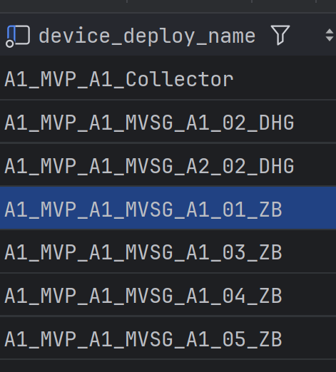

# Dashboard 左侧导航栏专用数据库表设计

## 一、任务

> 构建一个适配 dashboard 页的左侧导航栏，且新建一个数据库表用于该导航栏，左侧导航栏固定两级。


第一级是业务系统分类（如电气系统、BA系统、消防系统等），

第二级是子系统/设备分组（如电气系统下的中压/低压/UPS），

具体路径：点击节点后右侧以列表形式展示设备，点击设备可跳转到图形监控页面。


## 二、设计思路

### 2.1 新建专用导航表：nav_node

因此决定**新建一张专用的导航节点表 `nav_node`**，承载两级业务分类，并在设备部署表上加外键字段表达设备归属。导航分类本身是一个独立的业务概念，不应硬塞进设备表。


### 2.2 两级结构

导航表采用 `parent_id` 自关联实现两级：

- **一级节点**（`node_level=1`，`parent_id=NULL`）：业务系统分类，如"电气系统"、"消防系统"
- **二级节点**（`node_level=2`，`parent_id=一级节点ID`）：子系统，如"中压系统"、"低压系统"


### 2.3 设备归属：外键

在 `device_deployment` 表上新增 `nav_node_id` 外键字段，指向所属的二级导航节点。这样设备与导航分类解耦清晰：导航表只管分类，设备表只管设备，两者通过外键关联。


## 三、数据库表设计

### 3.1 新建导航表 `nav_node`

| 字段名      | 类型         | 约束 / 默认值                                         | 注释                                   |
| ----------- | ------------ | ----------------------------------------------------- | -------------------------------------- |
| node_id     | bigint       | NOT NULL, AUTO_INCREMENT, PRIMARY KEY                 | 导航节点ID                             |
| parent_id   | bigint       | DEFAULT NULL                                          | 父节点ID；一级为NULL，二级指向所属一级 |
| node_name   | varchar(100) | NOT NULL                                              | 节点显示名                             |
| node_level  | tinyint      | NOT NULL                                              | 层级：1=一级分类，2=二级分类           |
| node_type   | varchar(30)  | NOT NULL, DEFAULT 'group'                             | 节点类型：group=设备分组               |
| icon        | varchar(50)  | DEFAULT NULL                                          | 前端图标名，一级节点用                 |
| sort_order  | int          | NOT NULL, DEFAULT 0                                   | 同级排序序号                           |
| is_deleted  | tinyint(1)   | NOT NULL, DEFAULT 0                                   | 逻辑删除                               |
| create_time | datetime     | DEFAULT CURRENT_TIMESTAMP                             | 创建时间                               |
| update_time | datetime     | DEFAULT CURRENT_TIMESTAMP ON UPDATE CURRENT_TIMESTAMP | 更新时间                               |


### 3.2 设备部署表加外键字段（黄色标记）

| 字段                | 类型           | 可空        | 键          | 说明                                       |
| ------------------- | -------------- | ----------- | ----------- | ------------------------------------------ |
| device_deploy_id    | bigint         | NO          | PRI         | 设备部署ID（主键，自增）                   |
| device_tmpl_id      | bigint         | NO          | MUL         | 关联设备模板ID                             |
| ==**nav_node_id**== | ==**bigint**== | ==**YES**== | ==**MUL**== | ==**所属导航二级节点ID（本次新增外键）**== |
| face_plate_id       | varchar(160)   | YES         |             | 关联fuxa面板ID                             |
| alarm_code          | varchar(200)   | YES         | MUL         | 报警策略码                                 |
| device_deploy_name  | varchar(100)   | NO          | UNI         | 设备部署名（唯一）                         |
| device_alias        | varchar(100)   | YES         |             | 设备别名                                   |
| n4_address          | varchar(200)   | NO          | MUL         | N4 topic路径                               |
| ip_address          | varchar(45)    | YES         |             | 管理IP                                     |
| mac_address         | varchar(17)    | YES         |             | MAC地址                                    |
| sys_sort_order      | int            | YES         |             | 排序序号                                   |
| status              | tinyint        | YES         | MUL         | 状态：1在线 2离线 3维护 4故障              |
| install_date        | date           | YES         |             | 安装日期                                   |
| warranty_expire     | date           | YES         |             | 保修到期                                   |
| location            | varchar(50)    | YES         |             | 所属区域（全为NULL）                       |
| department          | varchar(100)   | YES         |             | 归属部门（全为NULL）                       |
| responsible_person  | varchar(50)    | YES         |             | 责任人                                     |
| contact_phone       | varchar(20)    | YES         |             | 联系电话                                   |
| extra_attrs         | json           | YES         |             | 扩展属性                                   |
| create_time         | datetime       | YES         |             | 创建时间                                   |
| update_time         | datetime       | YES         |             | 更新时间                                   |
| is_deleted          | tinyint(1)     | YES         |             | 逻辑删除标记                               |


## 为什么要加 `nav_node_id` 外键

核心：设备表和导航表是两张独立的表，需要一个"桥梁"把它们关联起来

- `nav_node` 表：存的是分类
- `device_deployment` 表：存的是设备（如A1_MVP_A1_MVSG_A1_01_ZB）

加入外键，构造桥梁：

```
nav_node 表                                      device_deployment 表
┌─────────────────────┐              ┌──────────────────────────────────┐
│ node_id=20          │ ◄──────────    │ device_deploy_id=4                     │
│ node_name=低压系统   │   外键指向         │ device_deploy_name=A1_MVP_A1_...ZB     │
│ node_level=2        │                  │ nav_node_id=20                         │
└─────────────────────┘              └──────────────────────────────────┘
```


### 3.3 两级分类数据

**8 个一级节点**：

| 序号 | 一级分类 |
|:-:|:-:|
| 1 | 房间/方舱类型 |
| 2 | 电气系统图 |
| 3 | 电气系统 |
| 4 | BA系统 |
| 5 | 设备总览 |
| 6 | 柴油发电机系统/油路系统 |
| 7 | 消防系统 |
| 8 | 自定义 |


**21 个二级节点**：

| 一级 | 二级节点 |
|:-:|:-:|
| 房间/方舱类型 | DataHall Room25、Public Area GF、Public Area RF、A1 PTU-A、A1 PTU-B |
| 电气系统图 | 电气系统图总览、PTU单独系统图 |
| 电气系统 | 中压系统、低压系统、UPS系统、直流系统、采集网关 |
| BA系统 | 风冷系统、液冷系统 |
| 设备总览 | 温湿度、空调系统 |
| 柴油发电机系统/油路系统 | 柴油发电机系统、油路系统 |
| 消防系统 | 气体灭火/极早期、水消防/水压监测 |
| 自定义 | 自定义分组/模板 |


### 3.4 真实设备挂载

从远程数据库导入 47 台真实设备，根据设备类型（`device_type`）映射到对应的二级节点：

| 设备类型 | 数量 | 归属二级节点 | 说明 |
|---|---|---|---|
| EM | 17 | 低压系统 | 电表，位于 MVSG 低压配电柜 |
| ZB | 15 | 低压系统 | 断路器/转换器，位于 MVSG 低压配电柜 |
| DHG | 2 | 中压系统 | |
| UDB | 1 | UPS系统 | 蓄电池 |
| EDB | 1 | UPS系统 | 蓄电池 |
| DCP | 1 | 直流系统 | 直流屏 |
| Collector | 1 | 采集网关 | 采集器 |
| IRC1 | 1 | 风冷系统 | 空调 |
| IRC2 | 1 | 风冷系统 | 空调 |
| DEHU | 1 | 空调系统 | 除湿器 |
| TH1 | 1 | 温湿度 | 温湿度传感器 |
| TH2 | 1 | 温湿度 | 温湿度传感器 |
| TH3 | 1 | 温湿度 | 温湿度传感器 |
| GAS1 | 1 | 气体灭火/极早期 | 氢气探测器 |
| GAS2 | 1 | 气体灭火/极早期 | 氢气探测器 |
| LD | 1 | 水消防/水压监测 | 漏水报警器 |


### 3.6 数据库最终状态【远程数据库：47.121.30.136】

本地 `n4_monitor` 库共 14 张表，新旧共存：

| 类别 | 表名 | 来源 |
|---|---|---|
| 旧表（原有，未改动） | device、product、monitor_point、dict_value、location、alarm_rule_boolean | 原有 |
| 远程导入的新表 | device_template、device_deployment、point_template、point_deployment | 从远程库复制 |
| 本次新建 | **nav_node** | 新建导航表 |
| 本次改动 | device_deployment（加 nav_node_id 字段） | 在远程导入基础上加外键 |


## 四、待确认事项

- [ ] （设备部署表、模板表），左侧导航栏如何设计？
- [ ] 经过扫描发现，`A1_MVP_A` / `A1_MVP_A1` 这类路径段在远程数据库中并非独立存储，而是从 `device_deploy_name` 和 `n4_address` 字段中拆分得到的，那么假如将“`A1_MVP_A`”作为第一层级，会遇到拆分字段值的问题。

> [!NOTE]
>
> 设备命名规范：`A1(楼号)_MVP(方仓类型)_A1(方仓编号)_MVSG(柜体名)_A1(第几排)_01(柜体编号)_EM(设备类型)。==目前数据库中的设备名长这样：“A1_MVP_A1_MVSG_A1_01_ZB”==。


拆分字段值，两套方案：

第一种是直接对字段值拆分，将这个device_deploy_name字段拆出“`A1_MVP_A`”作为第一层级：

> 

缺点：不好建索引；性能差每次查都要拆。

第二种方案：在 `device_deployment` 表加一个 `area` 字段，存 `A1_MVP_A1` 这种字段，然后查询直接 `WHERE area = 'A1_MVP_A1'`，不用拆分，能建索引。（我偏向第二种）

- [ ] 点击查看监控，进入后，左侧导航栏不太一样，我是设计成，点击查看监控，然后左侧导航栏会变成三级，这个看具体设备的图形监控会方便点

- [ ] 设备类型到导航分类的映射规则（如 ZB 归低压系统、DHG 归中压系统等）是根据设备类型语义和命名规范推断的，远程数据库中无业务分类字段可循，待确认。
- [ ] （非问题，做个提醒）目前右侧还是列表形式，相当于一个占位，到时候会换成方舱图。


